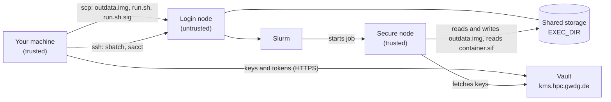
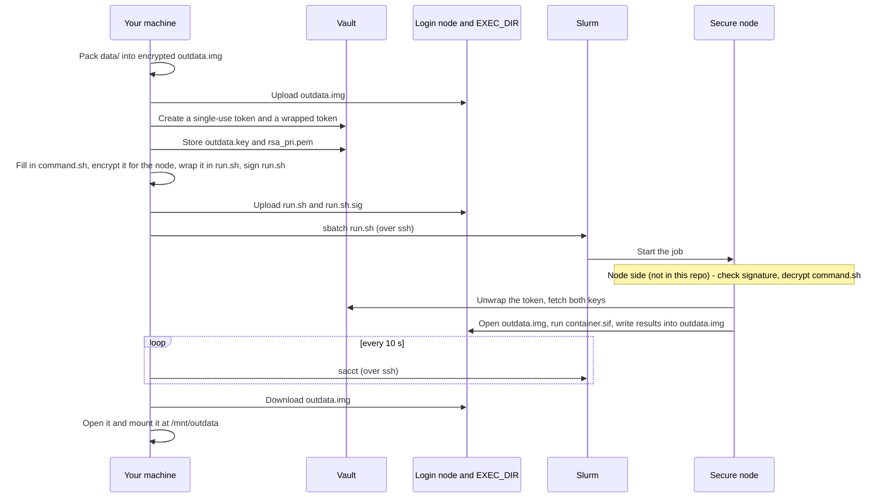

# Secure HPC client: how it works

This document describes the Secure HPC client in this repository: what each script does, in which order, and how the whole workflow fits together. It describes the code as it is, including its quirks.

Secure HPC is GWDG's implementation of the paper ["A Secure Workflow for Shared HPC Systems"](https://doi.org/10.1109/CCGrid54584.2022.00118) (CCGrid 2022). User documentation lives at <https://docs.hpc.gwdg.de/services/secure-hpc/>.

**Contents**

1. [Overview](#1-overview)
2. [Who sees what](#2-who-sees-what)
3. [One run, end to end](#3-one-run-end-to-end)
4. [Setup](#4-setup)
5. [Step-by-step reference](#5-step-by-step-reference)
6. [The job on the secure node](#6-the-job-on-the-secure-node)
7. [Interface between client and secure node](#7-interface-between-client-and-secure-node)
8. [Files and state](#8-files-and-state)
9. [Configuration values](#9-configuration-values)
10. [Behaviour notes](#10-behaviour-notes)

---

## 1. Overview

Secure HPC lets you process sensitive data on a shared HPC cluster. The shared parts of the cluster (login nodes, shared storage, Slurm) never see your data, keys or commands in plain text. Only two places are trusted:

- **Your machine** (the "secure client"): a Linux machine you control. Your data starts and ends here.
- **The secure node**: a compute node booted from the cluster's protected image server, locked down (no SSH logins, strict firewall) and given to one job at a time.

Everything that travels between the two is protected:

- your data, inside a LUKS-encrypted disk image (`outdata.img`)
- your software, inside an encrypted Apptainer/Singularity container (`container.sif`)
- your job script, encrypted for the secure node's GPG key and signed with your GPG key
- the keys, which go through a separate key server (Vault-compatible at `kms.hpc.gwdg.de`). The node fetches them with tokens that work only a few times.

This repository contains **only the client side**. One script, `secure_sbatch`, runs a whole job from start to finish. The commands that run on the secure node (`decrypt_and_execute`, `getkey`, `mount_data`, `umount_data`) are installed in the node image and are not yet part of this repository. [Section 7](#7-interface-between-client-and-secure-node) lists what the client expects from them.

### Repository files

| File | Purpose |
|---|---|
| [`secure_sbatch`](../secure_sbatch) | Main script. Runs the whole workflow ([section 5](#5-step-by-step-reference)). |
| [`prepare_scripts.sh`](../prepare_scripts.sh) | Creates Vault tokens, fills in `command.sh`, stores the keys in Vault. |
| [`command.sh.template`](../command.sh.template) | The job that runs on the secure node ([section 6](#6-the-job-on-the-secure-node)). Your own command goes here. |
| [`container.def`](../container.def) | Example Apptainer recipe (Ubuntu with a few tools). |
| [`sendkey.sh`](../sendkey.sh) | Stores one value in Vault. |
| [`utils/create_data_container.sh`](../utils/create_data_container.sh) | Creates an encrypted disk image and mounts it. |
| [`utils/umount_data_container.sh`](../utils/umount_data_container.sh) | Unmounts and closes an image, frees its loop devices. |
| [`utils/mount_data.sh`](../utils/mount_data.sh) | Opens and mounts a downloaded image. |
| [`utils/encrypt_script.sh`](../utils/encrypt_script.sh) | Encrypts a file with GPG for one recipient. |
| [`utils/README.md`](../utils/README.md) | Short usage notes for the helper scripts. |
| `data/` | Your input files. `data/input.txt` is a sample. |
| `secret/` | Holds your Vault token. |

---

## 2. Who sees what

| Party | Trusted | What it gets |
|---|---|---|
| Your machine | Yes | Everything in plain text: data, keys, tokens, job script |
| Login node | No | The encrypted image, the encrypted container, `run.sh` (job script encrypted inside) and its signature. Used for `scp`, `sbatch` and `sacct`, and optionally as an SSH proxy to Vault. |
| Shared storage (`EXEC_DIR`) | No | The same files, plus the job's Slurm log |
| Slurm | No | `run.sh` and the job's state |
| Vault | Holds the keys | The data key, the container key, the tokens |
| Secure node | Yes | Everything, while the job runs |

Data is only ever decrypted on your machine and on the secure node.



---

## 3. One run, end to end



### Mapping to the paper

| Paper step | In this repository |
|---|---|
| 1. Encrypt data and container | `utils/create_data_container.sh` packs `data/` into `outdata.img`. The container is encrypted once, by hand, during [setup](#4-setup). |
| 2. Upload data and keys | `scp outdata.img`. `prepare_scripts.sh` stores `outdata.key` and `rsa_pri.pem` in Vault. |
| 3. Submit job | `command.sh` is encrypted for the node, wrapped in `run.sh`, signed and submitted with `sbatch`. |
| 4. Resource allocation | Slurm, reservation `secure-hpc`. |
| 5. Verify identity | On the secure node, using `run.sh.sig` (node side). |
| 6. Decrypt batch script | `/usr/bin/decrypt_and_execute` on the secure node (node side). |
| 7. Retrieve keys | `command.sh`: unwrap the token, `getkey`. |
| 8. Mount data | `command.sh`: `mount_data`, then run the container. |
| Results | `secure_sbatch` waits, downloads `outdata.img` and mounts it locally. |

Differences from the paper:

- The batch script is signed with GPG instead of an S/MIME certificate.
- One encrypted image carries both the input and the results.
- Building and uploading the encrypted container is a manual setup step, not part of the script.

---

## 4. Setup

Everything here has to be in place before `./secure_sbatch` can succeed.

### 4.1 From GWDG (hpc-support@gwdg.de)

- An HPC account, an HPC Project, and access to the Slurm reservation `secure-hpc`.
- A Vault token. Save it as `secret/user_2.token`. Also ask for your Vault user name: the scripts use `user_2` (see [section 9](#9-configuration-values)).
- The secure node's public GPG key (`agq001.key`). Import it with `gpg --import agq001.key`.
- GWDG needs the public half of your GPG key (4.3) so the node can check your signature. Follow their instructions for handing it over.

### 4.2 Software on your machine

| Needed for | Tools |
|---|---|
| The run itself | `bash`, `sudo`, `cryptsetup`, `losetup`, `mkfs.ext4`, `dd`, `mount`, `realpath`, `gpg`, `vault`, `ssh`, `scp`, `gawk`, `awk`, `sed`, `grep` |
| Setup only | `apptainer` (or `singularity`), `ssh-keygen` |
| Optional | `tree` (debug output only) |

`gawk` is easy to miss, because Debian and Ubuntu ship `mawk` instead. The script uses `gawk` on your machine to read the job ID ([step 8](#step-8-upload-and-submit)).

### 4.3 Keys

**GPG key for signing.** Create one with `gpg --full-generate-key`. The script signs with `--local-user user_key`, which matches any key whose user ID (name or email) contains `user_key`. Either use that text in the key's name, or change the value in `secure_sbatch` ([section 9](#9-configuration-values)).

**Key pair for the container.** Create it in the repository folder. The files must be named exactly `rsa_pub.pem` and `rsa_pri.pem`:

```bash
ssh-keygen -t rsa -b 4096 -m pem -N "" -f rsa
ssh-keygen -f rsa.pub -e -m pem > rsa_pub.pem
mv rsa rsa_pri.pem && rm rsa.pub
```

### 4.4 Folder on the cluster

```bash
ssh USER@LOGIN_NODE 'mkdir -p EXEC_DIR && chmod 700 EXEC_DIR'
```

The folder must exist before the first run. Otherwise the first upload creates a file with that name and the later uploads fail. Keep it private, because the Slurm log ends up there. It must be on a file system the secure node can read.

### 4.5 Encrypted container

Put your software into `container.def`, then build the container encrypted with your public key and upload it:

```bash
sudo apptainer build --pem-path=rsa_pub.pem container.sif container.def
scp container.sif USER@LOGIN_NODE:EXEC_DIR/
```

The job expects it at `EXEC_DIR/container.sif`. No script in this repository builds or uploads it.

### 4.6 Edit the scripts

- Set `USER`, `LOGIN_NODE` and `EXEC_DIR` at the top of `secure_sbatch`.
- Change the other hardcoded values to match your account (all listed in [section 9](#9-configuration-values)).
- Put your command into `command.sh.template` ([section 6](#6-the-job-on-the-secure-node)).
- Put your input files into `data/`.

### 4.7 Checks

- `ssh USER@LOGIN_NODE true` works without typing a password. The script connects many times, once every 10 seconds while it waits, so an SSH key with `ssh-agent` is practical.
- Vault is reachable and your token is valid:
  ```bash
  export VAULT_ADDR=https://kms.hpc.gwdg.de:443
  export VAULT_TOKEN=$(cat secret/user_2.token)
  vault token lookup
  ```
  If your machine can't reach Vault directly, run `./secure_sbatch -p` ([options](#options)).
- `gpg --list-keys agq001` and `gpg --list-secret-keys user_key` both find a key.

---

## 5. Step-by-step reference

```text
./secure_sbatch [-h|--help] [-p|--proxy]
```

Run it from the repository folder; all paths are relative to it. It asks for your `sudo` password, and `gpg` may ask for your key's passphrase. No step checks for errors: if a command fails, the script prints the error and carries on.

Each step below lists where it runs, what it reads and writes, and the exact commands.

### Options

- `-h`, `--help`: print usage and exit.
- `-p`, `--proxy`: for machines that can't reach Vault directly. Opens a SOCKS proxy through the login node on local port 2020 and sends all later `vault` calls through it.
  ```bash
  # kill earlier proxies
  for pid in $(ps -ef | grep "ssh -fN -D 2020 $USER@$LOGIN_NODE" | awk '{print $2}'); do kill -9 $pid; done
  ssh -fN -D 2020 $USER@$LOGIN_NODE
  export HTTPS_PROXY="socks5://127.0.0.1:2020"
  export VAULT_ADDR="https://kms.hpc.gwdg.de"
  vault status
  ```
  The proxy keeps running after the script ends. The next `-p` run kills it and starts a new one.
- Any other argument ends option parsing and is otherwise ignored.

### Step 1: Clean up the previous run

|  |  |
|---|---|
| Runs on | Your machine: `./utils/umount_data_container.sh outdata /mnt` |
| Reads | Nothing |
| Changes | Unmounts `/mnt/outdata`, closes `/dev/mapper/outdata`, detaches loop devices whose `losetup -a` line contains `outdata` |
| Needs | `sudo` |

```bash
sudo umount /mnt/outdata
sudo cryptsetup luksClose outdata
# for each line of `sudo losetup -a | grep outdata`, take the first field ("/dev/loop3:"),
# drop the trailing ":" and detach it:
sudo losetup -d /dev/loop3
```

On a first run nothing is mounted, so these commands print errors. That's expected.

### Step 2: Create the encrypted data image

|  |  |
|---|---|
| Runs on | Your machine: `echo "YES" \| ./utils/create_data_container.sh outdata /mnt 100` |
| Reads | `/dev/urandom` |
| Writes | `outdata.img` (100 × 1 MiB) and `outdata.key` in the repository folder, replacing existing ones. Mounts the image at `/mnt/outdata`. |
| Needs | `sudo` |

```bash
loop_dev=$(sudo losetup -f)
dd if=/dev/zero of=outdata.img bs=1M count=100
tr -dc '0-9a-zA-Z' </dev/urandom | head -c 32 > outdata.key
sudo losetup $loop_dev outdata.img
sudo cryptsetup -c aes-xts-plain -s 512 luksFormat $loop_dev outdata.key
sudo cryptsetup luksOpen $loop_dev outdata --key-file outdata.key
sudo mkfs.ext4 /dev/mapper/outdata
sudo mkdir -p /mnt/outdata
sudo mount -t ext4 /dev/mapper/outdata /mnt/outdata
sudo chown -R $(whoami) /mnt/outdata
```

- `outdata.key` is a random 32-character passphrase that unlocks the image. A new one is made on every run.
- The piped `YES` answers the confirmation question of `cryptsetup luksFormat`.
- The script accepts only container names made of `a-z`, `A-Z` and `1-9`. `-h` or `--help` prints usage.

### Step 3: Fill the image and upload it

|  |  |
|---|---|
| Runs on | Your machine (`secure_sbatch`) |
| Reads | `data/*` |
| Writes | Your input files into the image, then `EXEC_DIR/outdata.img` on the cluster |

```bash
mount                                           # prints all mounts (debug output)
cp -rv data/* /mnt/outdata/
tree /mnt/outdata                               # debug output
./utils/umount_data_container.sh outdata /mnt   # as in step 1
scp outdata.img $USER@$LOGIN_NODE:$EXEC_DIR
```

The input and the job's results must both fit in the image. Encryption and file system overhead leave roughly 75 to 80 MB of the 100 MiB.

### Step 4: Create tokens, fill in the job script, store the keys

|  |  |
|---|---|
| Runs on | Your machine: `rm command.sh.asc`, then `./prepare_scripts.sh $EXEC_DIR` |
| Reads | `secret/user_2.token`, `command.sh.template`, `outdata.key`, `rsa_pri.pem` |
| Writes | `command.sh` (plain text, contains the tokens), two Vault entries, two new Vault tokens |
| Needs | Network access to Vault (directly or through `-p`) |

```bash
export VAULT_ADDR='https://kms.hpc.gwdg.de:443'
export VAULT_TOKEN=$(cat secret/user_2.token)

default_token=$(vault token create -tls-skip-verify -policy=default -use-limit=1 -field=token)
wrapped_token=$(vault token create -tls-skip-verify -policy=user_2-node -wrap-ttl=3000 \
                    -use-limit=3 -field=wrapping_token)

cp -f command.sh.template command.sh
sed -i "s/<DEFAULT_TOKEN>/$default_token/g" command.sh
sed -i "s/<WRAPPED_TOKEN>/$wrapped_token/g" command.sh
sed -i "s#<EXEC_DIR>#$EXEC_DIR#g" command.sh

./sendkey.sh data/user_2/outdata @outdata.key
./sendkey.sh data/user_2/rsa_pri @rsa_pri.pem
```

`sendkey.sh NAME VALUE` runs `vault kv put -tls-skip-verify secret/NAME key=VALUE`. A value starting with `@` is read from that file. So the two keys end up in Vault as `secret/data/user_2/outdata` and `secret/data/user_2/rsa_pri`, each in a field called `key`.

The two tokens:

- **Single-use token** (`default_token`): `default` policy, usable once. Goes into `command.sh` as `token_setup`.
- **Wrapped token** (`wrapped_token`): a response-wrapping token. Unwrapping it gives the real token, which has the `user_2-node` policy and can be used 3 times. The wrapping expires 3000 seconds (50 minutes) after it's created. Goes into `command.sh` as `token`.

Both tokens and `EXEC_DIR` are printed to the terminal. If a `vault` call fails, its placeholder is replaced with an empty string.

### Step 5: Encrypt the job script for the node

|  |  |
|---|---|
| Runs on | Your machine: `./utils/encrypt_script.sh command.sh agq001` |
| Reads | `command.sh`, the public key `agq001` in your GPG keyring |
| Writes | `command.sh.asc` |

```bash
gpg --armor --recipient agq001 --trust-model always --encrypt command.sh
cat command.sh.asc
```

- `--armor` produces text output, which is needed because it's pasted into `run.sh`.
- `--trust-model always` uses the key without requiring you to mark it as trusted.
- Step 4 deleted the old `command.sh.asc` first, so `gpg` doesn't stop to ask about overwriting it.

If encryption fails, `run.sh` is still built (without the message), signed and submitted.

### Step 6: Wrap it in `run.sh`

|  |  |
|---|---|
| Runs on | Your machine (`secure_sbatch`) |
| Reads | `command.sh.asc` |
| Writes | `run.sh` |

```bash
rm run.sh
echo "#!/bin/bash" > run.sh
echo "/usr/bin/decrypt_and_execute <<EOF" >> run.sh
cat command.sh.asc >> run.sh
echo -n "EOF" >> run.sh
cat run.sh
```

The result looks like this. The last line, `EOF`, has no newline after it.

```text
#!/bin/bash
/usr/bin/decrypt_and_execute <<EOF
-----BEGIN PGP MESSAGE-----

hQIMA...
...
-----END PGP MESSAGE-----
EOF
```

When Slurm runs this file as the batch script, bash passes the encrypted message to `decrypt_and_execute` on standard input. `run.sh` is the only script Slurm sees, and apart from its first two lines it's encrypted.

### Step 7: Sign `run.sh`

|  |  |
|---|---|
| Runs on | Your machine (`secure_sbatch`) |
| Reads | `run.sh`, your private GPG key `user_key` |
| Writes | `run.sh.sig` |

```bash
rm run.sh.sig
gpg --detach-sign --local-user user_key -o run.sh.sig run.sh
```

`run.sh.sig` is a separate binary signature over the exact bytes of `run.sh`.

### Step 8: Upload and submit

|  |  |
|---|---|
| Runs on | Your machine, then the login node over SSH |
| Reads | `run.sh`, `run.sh.sig` |
| Writes | Both files in `EXEC_DIR`, a new Slurm job |

```bash
scp run.sh run.sh.sig $USER@$LOGIN_NODE:$EXEC_DIR
slurmid=$(ssh "$USER@$LOGIN_NODE" \
            "cd $(printf '%q' "$EXEC_DIR") && \
             /usr/local/slurm/slurm/current/install/bin/sbatch --reservation=secure-hpc run.sh" \
          | gawk '{print $4}')
echo $slurmid
sleep 5
```

- `sbatch` prints `Submitted batch job 12345`. `gawk` runs on your machine and takes the fourth word as the job ID.
- The job is submitted with the reservation and nothing else, so time, GPUs and memory are Slurm's defaults.
- Slurm writes the job's log to `EXEC_DIR` (by default `slurm-<jobid>.out`).

### Step 9: Wait for the job

|  |  |
|---|---|
| Runs on | Your machine, querying the login node over SSH every 10 seconds |

```bash
while [[ $(ssh $USER@$LOGIN_NODE "/usr/local/slurm/slurm/current/install/bin/sacct -b -j $slurmid | gawk '{print $2}' | awk 'FNR > 2' | grep -v COMPLETED") != "" ]]; do
    echo "Waiting for job to end!"
    sleep 10
done
```

`sacct -b` lists the job and its steps (job ID, state, exit code) after two header lines. The loop drops every line containing `COMPLETED` and keeps waiting while anything is left. It ends once every line says `COMPLETED`.

The whole remote command is in double quotes, so your local shell replaces `$2` before SSH sends it. `$2` is normally empty, so `gawk` prints whole lines, and the `grep` works on those.

### Step 10: Download and open the results

|  |  |
|---|---|
| Runs on | Your machine: `scp`, then `./utils/mount_data.sh outdata` |
| Reads | `EXEC_DIR/outdata.img`, `outdata.key` |
| Writes | `outdata.img` in the repository folder, a copy in a temporary folder, a mount at `/mnt/outdata` |
| Needs | `sudo` |

```bash
scp $USER@$LOGIN_NODE:$EXEC_DIR/outdata.img ./outdata.img
```

`utils/mount_data.sh outdata` then does:

```bash
key_file=$(realpath outdata.key)
# copy the image and work in: $LOCAL_TMPDIR if set, else $TMP if set, else /tmp
cp outdata.img <temp folder>; cd <temp folder>
sudo cryptsetup luksOpen outdata.img outdata --key-file $key_file
sudo mkdir -p /mnt/outdata
sudo mount -o rw,noexec,nosuid,nodev -t ext4 /dev/mapper/outdata /mnt/outdata
sudo chmod 711 -R /mnt/outdata
sudo chown -R $(whoami) /mnt/outdata
sudo chmod 700 -R /mnt/outdata
ls -l /mnt/outdata
```

The results appear in `/mnt/outdata`, mounted from the copy in the temporary folder. The downloaded `outdata.img` in the repository folder stays unchanged. The mount stays in place until step 1 of the next run. The mount point is always `/mnt/<name>`.

---

## 6. The job on the secure node

`command.sh.template` is the job itself. Step 4 fills in its placeholders, step 5 encrypts it, and on the secure node `decrypt_and_execute` decrypts and runs it. In order, it does the following.

**1. Set up Vault access.**

```bash
token_setup=<DEFAULT_TOKEN>
token=<WRAPPED_TOKEN>
exec_dir=<EXEC_DIR>

export VAULT_ADDR='https://kms.hpc.gwdg.de'
VAULT_TOKEN=$token_setup
token=$(vault unwrap -tls-skip-verify -field=token $token)
export VAULT_TOKEN=$token
```

`vault unwrap` exchanges the wrapping token for the real token (`user_2-node` policy, 3 uses), which then becomes `VAULT_TOKEN`. The line `VAULT_TOKEN=$token_setup` sets the variable without exporting it, so the single-use token reaches `vault` only if `VAULT_TOKEN` is already exported in the job's environment. A commented-out line at the top (`# /opt/secure_workflow/deactivate_slurmd.sh`) does nothing.

**2. Fetch the keys.**

```bash
getkey user_2 outdata
getkey user_2 rsa_pri
```

`getkey` is a node command. It fetches the two keys stored in step 4. The job then uses the container key as `/keys/$SLURM_JOB_ID/rsa_pri.key`.

**3. Open the data image.**

```bash
mount_data outdata $exec_dir
ls /keys/${SLURM_JOB_ID}
```

`mount_data` is a node command. It opens `EXEC_DIR/outdata.img`, and the job then uses its contents at `/data/u19997/$SLURM_JOB_ID/outdata/`. The user name `u19997` is hardcoded in the template (marked TODO).

**4. Run the container.**

```bash
/usr/local/bin/singularity exec --nv --pem-path=/keys/${SLURM_JOB_ID}/rsa_pri.key \
    --bind /data/u19997/${SLURM_JOB_ID}/outdata/:/output/ \
    $exec_dir/container.sif \
    bash -c 'echo "In the input file was: \"$(cat /output/input.txt)\"" > /output/output.txt'
ls /data/u19997/${SLURM_JOB_ID}/outdata
```

- `--pem-path` decrypts the container with your private key.
- `--bind` makes the opened image available as `/output`.
- `--nv` enables NVIDIA GPU support.
- The command after `bash -c` replaces the container's own run script. This is the line to change for your own job.

The example writes `/output/output.txt` with the text `In the input file was: "<contents of input.txt>"`. Anything written under `/output` ends up inside the encrypted image.

**5. Close the data image.**

```bash
umount_data outdata
```

`umount_data` is a node command. `command.sh` itself doesn't delete the keys under `/keys`.

The output of every `echo` and `ls` in the job goes to the Slurm log in `EXEC_DIR`.

---

## 7. Interface between client and secure node

The node side isn't in this repository. This section lists what the client produces and what it expects the node to provide.

### What the client delivers

| Item | Form |
|---|---|
| Batch script | `EXEC_DIR/run.sh`, exactly as in [step 6](#step-6-wrap-it-in-runsh), submitted from `EXEC_DIR` with `sbatch --reservation=secure-hpc run.sh` |
| Signature | `EXEC_DIR/run.sh.sig`, a detached binary GPG signature of `run.sh` made with your key |
| Job script | `command.sh`, encrypted for GPG key `agq001`, text-armored, inside `run.sh` |
| Data image | `EXEC_DIR/outdata.img`: LUKS, cipher `aes-xts-plain` with a 512-bit key, ext4 inside, unlocked by the contents of `outdata.key` |
| Container | `EXEC_DIR/container.sif`, encrypted with `rsa_pub.pem` |
| Keys in Vault | `secret/data/user_2/outdata` and `secret/data/user_2/rsa_pri`, each with the value in the field `key` |
| Tokens | One single-use `default` token and one wrapping token (expires after 3000 s) for a `user_2-node` token with 3 uses, both written into `command.sh` |

### What the node must provide

| Command | Called as | Expected behaviour |
|---|---|---|
| `/usr/bin/decrypt_and_execute` | From `run.sh`, encrypted job script on standard input | Decrypt with the node's private key and run the job script. Per the design, the signature in `run.sh.sig` is checked on the node before this. |
| `vault` | `vault unwrap ...` | HashiCorp Vault command-line tool |
| `getkey` | `getkey <vault user> <name>` | Fetch the key stored as `<name>` in step 4. The container key must end up at `/keys/$SLURM_JOB_ID/rsa_pri.key`. |
| `mount_data` | `mount_data <image name> <folder>` | Open `<folder>/<image name>.img` and mount it so it appears at `/data/<user>/$SLURM_JOB_ID/<image name>/` |
| `umount_data` | `umount_data <image name>` | Unmount and close the image |
| `/usr/local/bin/singularity` | `singularity exec --nv --pem-path=... --bind ...` | Singularity/Apptainer with support for encrypted containers |

The job also relies on Slurm setting `SLURM_JOB_ID`.

---

## 8. Files and state

| Item | Where | Created by | Contents | Lifetime |
|---|---|---|---|---|
| `secret/user_2.token` | Your machine | You (from GWDG) | Your Vault token, **secret** | Permanent |
| `rsa_pub.pem` | Your machine | You (setup) | Public key for encrypting the container | Permanent |
| `rsa_pri.pem` | Your machine, Vault | You (setup), stored in Vault in step 4 | Private key that decrypts the container, **secret** | Permanent. Overwritten in Vault on every run, never deleted by the client |
| `container.def` | Your machine | You | Container recipe | Permanent |
| `container.sif` | Your machine, `EXEC_DIR` | You (setup) | Encrypted container | Until you replace it |
| `data/*` | Your machine | You | Input data, **plain text** | Permanent |
| `outdata.img` | Your machine, `EXEC_DIR` | Step 2, uploaded in step 3, downloaded in step 10 | Encrypted image with input and results | Replaced on every run |
| `outdata.key` | Your machine, Vault | Step 2, stored in Vault in step 4 | Passphrase for the image, **secret** | Replaced on every run. Never deleted from Vault by the client |
| `/mnt/outdata` | Your machine | Steps 2 and 10 | Decrypted view of the image | Until step 1 of the next run |
| `<temp folder>/outdata.img` | Your machine | Step 10 | Copy of the downloaded image, mounted at `/mnt/outdata` | Replaced on the next run |
| `command.sh` | Your machine | Step 4 | Job script with tokens, **plain text, secret** | Replaced on every run |
| `command.sh.asc` | Your machine | Step 5 | Encrypted job script | Replaced on every run |
| `run.sh` | Your machine, `EXEC_DIR` | Steps 6 and 8 | Batch script with the encrypted job inside | Replaced on every run |
| `run.sh.sig` | Your machine, `EXEC_DIR` | Steps 7 and 8 | Signature of `run.sh` | Replaced on every run |
| `slurm-<jobid>.out` | `EXEC_DIR` | Slurm | Job output, **plain text** (includes the `ls` listings from [section 6](#6-the-job-on-the-secure-node)) | One per job, kept |
| Single-use token | Vault | Step 4 | `default` policy, 1 use | Until used or expired |
| Wrapping token | Vault | Step 4 | Wraps a `user_2-node` token with 3 uses | Until unwrapped or 3000 s after creation |
| `agq001` public key | Your GPG keyring | You (setup) | Secure node's public key | Permanent |
| `user_key` key pair | Your GPG keyring | You (setup) | Your signing key | Permanent |
| Proxy on port 2020 | Your machine | `-p` | SSH SOCKS proxy through the login node | Until the next `-p` run or until killed |

---

## 9. Configuration values

All of these are written directly into the scripts.

| File:line | Value | Meaning |
|---|---|---|
| `secure_sbatch:5` | `USER="YOURUSERNAME"` | Your cluster user name |
| `secure_sbatch:7` | `LOGIN_NODE="glogin7.hpc.gwdg.de"` | Login node for `scp` and `ssh` |
| `secure_sbatch:9` | `EXEC_DIR="/mnt/ceph-hdd/cold/your_path"` | Folder on the cluster for all job files |
| `secure_sbatch:27, 29, 31` | `2020` | Local port of the SSH proxy (`-p`) |
| `secure_sbatch:32` | `https://kms.hpc.gwdg.de` | Vault address in proxy mode |
| `secure_sbatch:44, 46, 50, 53` | `outdata`, `/mnt` | Image name and local mount folder |
| `secure_sbatch:46` | `100` | Image size in MiB |
| `secure_sbatch:65` | `agq001` | GPG key of the secure node |
| `secure_sbatch:74` | `/usr/bin/decrypt_and_execute` | Path of the decryption command on the node |
| `secure_sbatch:83` | `user_key` | Your GPG signing key |
| `secure_sbatch:92` | `/usr/local/slurm/slurm/current/install/bin/sbatch` | `sbatch` path on the login node |
| `secure_sbatch:92` | `--reservation=secure-hpc` | Slurm reservation (the only `sbatch` option) |
| `secure_sbatch:97` | `5` | Seconds to wait after submitting |
| `secure_sbatch:100` | `/usr/local/slurm/slurm/current/install/bin/sacct`, `10` | `sacct` path and polling interval in seconds |
| `prepare_scripts.sh:5` | `https://kms.hpc.gwdg.de:443` | Vault address |
| `prepare_scripts.sh:7` | `secret/user_2.token` | Your Vault token file |
| `prepare_scripts.sh:12` | `-policy=default -use-limit=1` | Single-use token |
| `prepare_scripts.sh:13–14` | `-policy=user_2-node -wrap-ttl=3000 -use-limit=3` | Wrapped token: policy, expiry of the wrapping in seconds, uses |
| `prepare_scripts.sh:29–30` | `data/user_2/outdata`, `data/user_2/rsa_pri`, `outdata.key`, `rsa_pri.pem` | Vault names and local key files |
| `command.sh.template:10` | `https://kms.hpc.gwdg.de` | Vault address on the node |
| `command.sh.template:17–18` | `user_2` | Vault user name for `getkey` |
| `command.sh.template:26, 28` | `u19997` | User name in the node's data path (marked TODO) |
| `command.sh.template:26` | `/usr/local/bin/singularity` | Singularity path on the node |
| `command.sh.template:27` | `bash -c '...'` | The command your job runs |
| `utils/create_data_container.sh:18` | `32`, `0-9a-zA-Z` | Length and characters of the image passphrase |
| `utils/create_data_container.sh:20` | `aes-xts-plain`, `512` | LUKS cipher and key size |
| `utils/create_data_container.sh:22` | `ext4` | File system inside the image |
| `utils/mount_data.sh:25, 27` | `/mnt` | Mount folder for downloaded images |

---

## 10. Behaviour notes

How the scripts behave in situations the steps above don't cover.

- **Errors don't stop the run.** No script checks return codes. On a first run you'll see harmless messages such as `rm: cannot remove 'command.sh.asc'` or "not mounted". Real errors are reported the same way and the run carries on.
- **TLS certificate checks are off.** Every `vault` call in the client and in the job uses `-tls-skip-verify`. The connection is encrypted, but the server's identity isn't checked. In proxy mode (`-p`), the connection to Vault leaves through the login node.
- **Key fetching has a time limit.** The wrapping token expires 3000 seconds (50 minutes) after step 4. A job that starts later can't fetch its keys.
- **The wait loop has blind spots.** It ends only when every line from `sacct` says `COMPLETED`. A job that ends as `FAILED`, `CANCELLED`, `TIMEOUT` or any other state keeps the loop waiting until you press Ctrl+C. If the job ID is empty (for example because `gawk` is missing) or `ssh` fails, the loop ends at once, and step 10 downloads the image as it was before the job ran.
- **Results are replaced on the next run.** Every run creates a new `outdata.key` and replaces `outdata.img`, both locally and on the cluster. Copy your results out of `/mnt/outdata` before starting another run.
- **Some things stay behind after a run:**
  - the `/mnt/outdata` mount (until the next run)
  - the SSH proxy from `-p`
  - `command.sh`, with its tokens in plain text
  - the keys in Vault
- **Secrets are printed to the terminal.** Step 4 prints both tokens.
- **The Slurm log is plain text.** The example job lists the key folder and the data folder, so file names appear in `EXEC_DIR/slurm-<jobid>.out`.
- **Generated files aren't ignored by git.** The repository has no `.gitignore`, so tokens, keys and images created in the repository folder show up as new files.
- **The comments don't always match the code.** `utils/README.md` mentions `../run_workflow` and says `mount_data.sh` encrypts the image (it opens it). Comments in `utils/encrypt_script.sh` mention a `.gpg` file (the output is `.asc`). One comment in `secure_sbatch` says `commans.sh.asc`.
